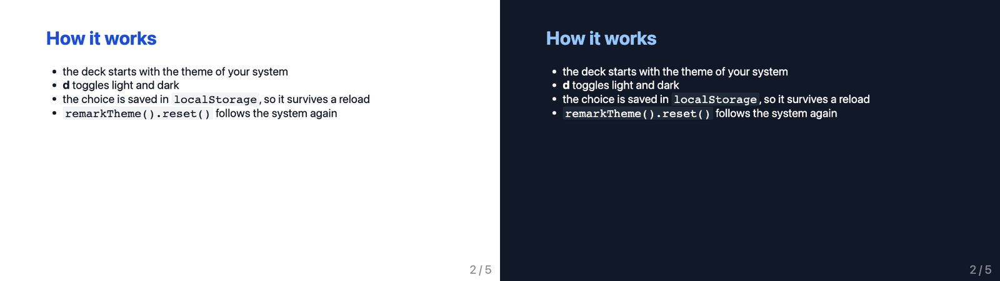

# remarkjs-theme 🌓

<!-- prettier-ignore-start -->
[](https://github.com/piecioshka/remarkjs-theme/actions/workflows/ci.yml)
[](https://piecioshka.mit-license.org)
<!-- prettier-ignore-end -->

> Light and dark theme for [remark.js](https://github.com/gnab/remark) slides. The deck starts with the theme of the system, `d` switches it, and the choice survives a reload.

[](https://piecioshka.github.io/remarkjs-theme/demo/)

**Demo:** <https://piecioshka.github.io/remarkjs-theme/demo/> (press `d`)

## Features ✨

- 🖥️ Follows the system _(`prefers-color-scheme`, live, until you pick a theme yourself)_
- ⌨️ One key to switch _(`d` by default; `t` is taken by remark's timer reset)_
- 💾 Remembers the choice _(`localStorage`, survives a reload)_
- ⚡ No flash _(the theme is set before remark renders the first slide)_
- ❓ The shortcut shows up on remark's help screen _(`?` or `h`)_
- 🎨 Your CSS, your colors _(the plugin only sets `data-theme` on `<html>`)_
- 📣 Fires `remark-theme-change` _(for diagrams and charts that need to repaint)_
- 📦 One file, zero dependencies besides remark.js

## Installation 📦

### 1. Get the file

Download [`remark-theme.js`](remark-theme.js) next to your slides, for example to `vendor/`:

```bash
curl -fsSL -o vendor/remark-theme.js \
  https://raw.githubusercontent.com/piecioshka/remarkjs-theme/v0.1.0/remark-theme.js
```

Or load it straight from jsDelivr:

```html
<script src="https://cdn.jsdelivr.net/gh/piecioshka/remarkjs-theme@v0.1.0/remark-theme.js"></script>
```

### 2. Call it before `remark.create()`

```html
<script src="vendor/remark.min.js"></script>
<script src="vendor/remark-theme.js"></script>
<script>
  const theme = remarkTheme();
  const slideshow = remark.create({ sourceUrl: "slides.md" });
</script>
```

### 3. Style both themes

The plugin sets `data-theme="light"` or `data-theme="dark"` on `<html>`. Put your colors in custom properties and override them for one of the themes:

```css
:root {
  --bg: #ffffff;
  --fg: #111827;
}

:root[data-theme="dark"] {
  --bg: #111827;
  --fg: #f9fafb;
}

.remark-slide-content {
  background: var(--bg);
  color: var(--fg);
}
```

That's it. Press `d` to switch. The new shortcut is also listed on the help screen (`?`).

> [!NOTE]
> Call `remarkTheme()` before `remark.create()` and with the script at the end of `<body>`. The attribute lands on `<html>` before the first paint, so the slides never flash in the wrong theme.

## Options ⚙️

```js
remarkTheme({
  key: "d", // key that toggles the theme
  attribute: "data-theme", // attribute set on <html>
  storageKey: "remark-theme", // localStorage key for the user's choice
  helpText: "Toggle light / dark theme", // label on the help screen
});
```

## API 🧰

```js
const theme = remarkTheme();

theme.get(); // "light" or "dark"
theme.set("dark"); // picks a theme and remembers it
theme.toggle(); // same as pressing the key
theme.reset(); // forgets the choice, follows the system again

document.documentElement.addEventListener("remark-theme-change", (event) => {
  console.log(event.detail.theme); // "light" or "dark"
});
```

## Browser support 🌐

Any browser with `matchMedia` change events and `CustomEvent`: every evergreen browser.

## Contributing 🤝

See [CONTRIBUTING.md](CONTRIBUTING.md).

## License 📄

[The MIT License](https://piecioshka.mit-license.org) @ 2026
